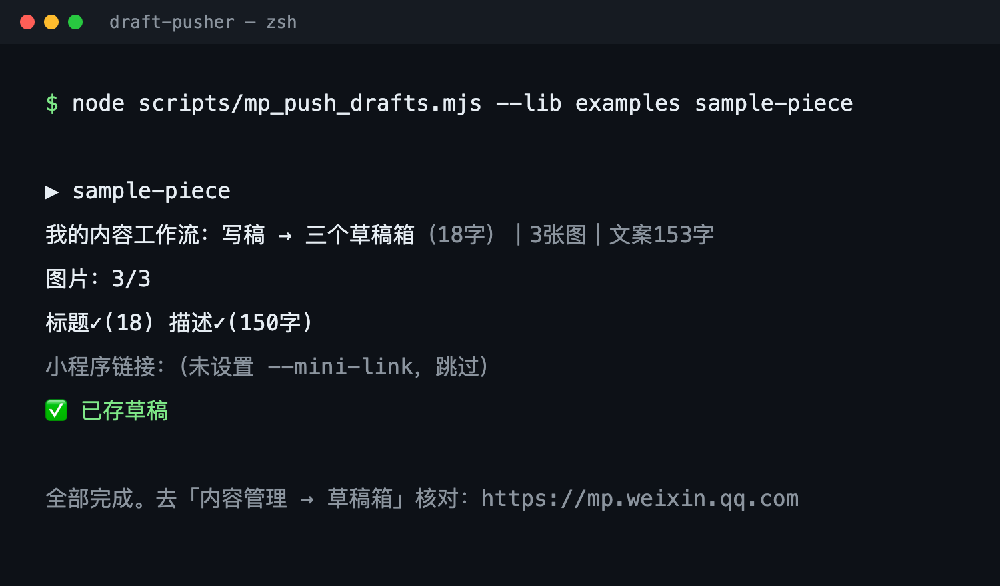
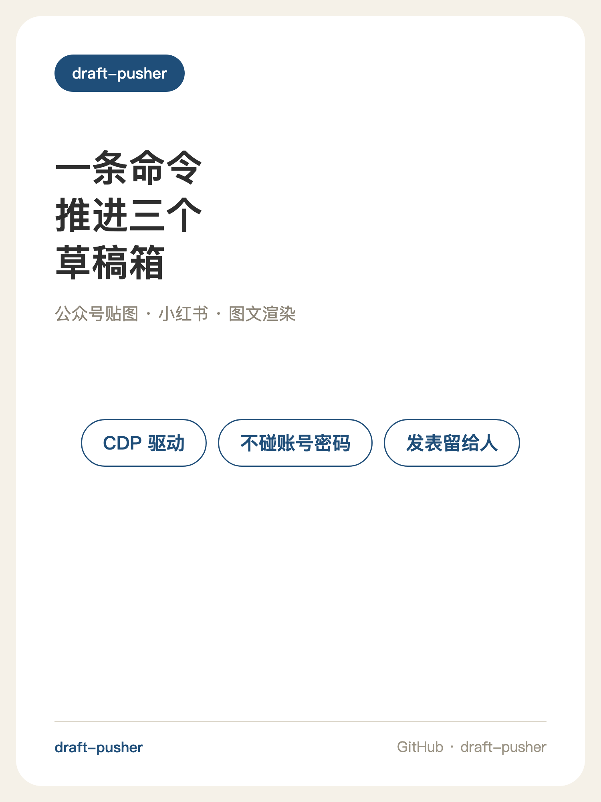
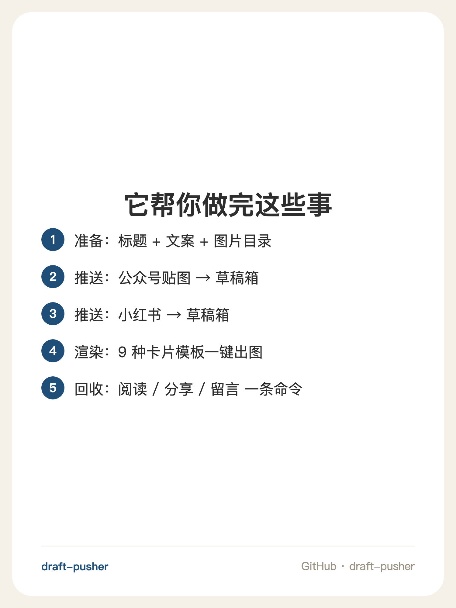
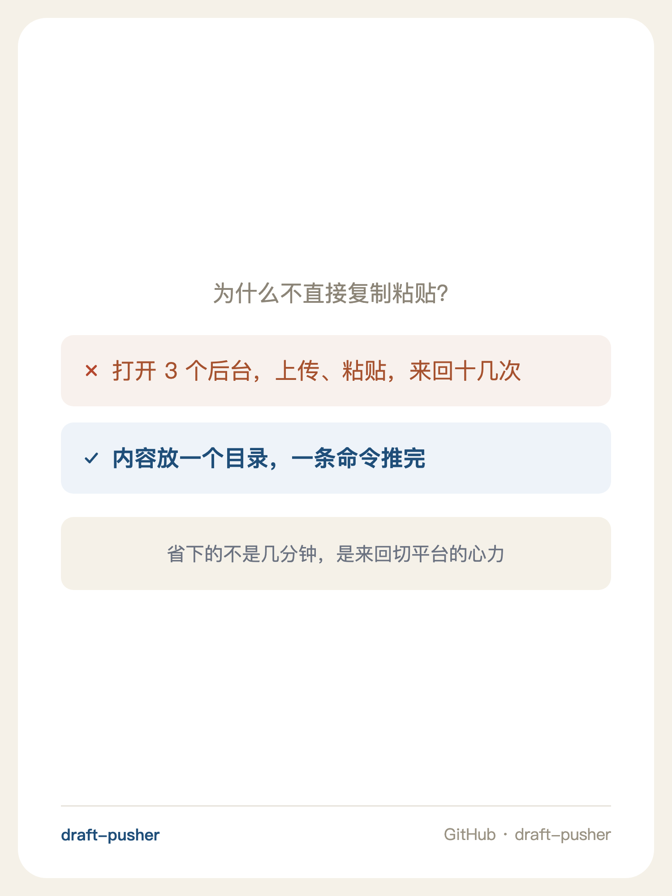
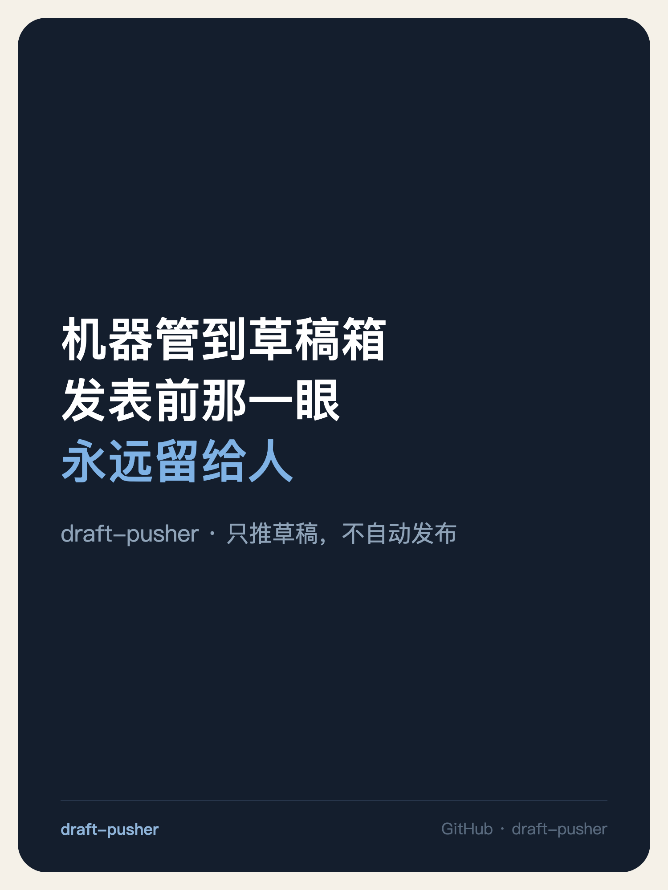

# 📮 draft-pusher · 草稿推送器

> **把内容推进草稿箱，发表留给人。**
> Push content into WeChat / Xiaohongshu drafts — with your own logged-in browser, via CDP.

一条命令，把「标题 + 文案 + 图片」的目录推进**微信公众号「贴图」**和**小红书草稿箱**。
不模拟登录、不碰账号密码、后台静默运行——**最后那一下「发表」，永远由人来做**。

[SKILL.md（给 AI Agent 用）](SKILL.md) · [License](LICENSE)

| 出口 | 形态 | 状态 |
|---|---|---|
| 微信公众号 · 贴图 | 图片卡片（newspic） | ✅ 完整流水线 |
| 微信公众号 · 图文 | 长文章（news） | 编辑器结构已探明（见 `references/`） |
| 小红书 | 图文笔记 | ✅ 完整流水线 |

附带两个渲染器：**卡片渲染器**（9 种卡型，`cards.json → 1500×2000`）和**手机壳营销图渲染器**（真实 iPhone 15 Pro 几何，`截图 → 1242×1660`）。

## 📸 效果

**一条命令，推进草稿箱** —— 下面是真实运行记录（对 `examples/` 里的示例内容实跑）：



**卡片渲染器的产出** —— 这几张图本身就是用本仓库的渲染器生成的（规格见 `docs/promo/cards.json`）：

| 封面卡 | 清单卡 | 对比卡 | 情绪卡 |
|---|---|---|---|
|  |  |  |  |

## ✨ 功能特性

- **微信公众号「贴图」** —— 内容目录一键进草稿箱：图片全自动上传、标题/描述填入、可选插入小程序链接
- **小红书** —— 封面 + 内页图 + 标题 + 正文 → 草稿箱
- **数据回收** —— 已发表贴图的 阅读 / 分享 / 留言 / 点赞 / 收藏 / 转发 + 账号概览，一条命令
- **卡片渲染器** —— `cards.json` → 1500×2000 卡片，9 种卡型：封面 / 词卡 / 范句卡 / 避坑卡 / 截图卡 / 清单卡 / 时间线 / 短句卡 / 情绪卡
- **手机壳营销图** —— App 截图 → 1242×1660，真实设备几何
- **后台标签** —— 核验与操作都在隐藏标签里进行，不抢你正在看的窗口；锁屏也能跑
- **零 npm 依赖** —— Node 原生 `fetch` / `WebSocket`，只需要一个 Chrome

## 🚀 快速开始

> 需要：**Node 18+**、**Chrome**；渲染器还需要 Python 3.8+（Pillow 可选）

```bash
git clone https://github.com/wsj414855138-code/draft-pusher.git && cd draft-pusher

# ① 启动调试 Chrome（独立 profile；首次在弹出的窗口里登录两个平台）
./scripts/start-chrome.sh
#    · 登录 mp.weixin.qq.com（公众号后台）
#    · 登录 creator.xiaohongshu.com（小红书创作平台）

# ② 验证连通（应列出标签页）
node scripts/cdp.mjs list

# ③ 一条命令 → 公众号贴图草稿箱
node scripts/mp_push_drafts.mjs --lib examples sample-piece

# ④ 一条命令 → 小红书草稿箱（标题默认读 标题.txt，可用 --title 覆盖）
node scripts/xhs_push_direct.mjs --lib examples sample-piece

# ⑤（可选）渲染卡片：cards.json → img/
python3 scripts/render/render_tietu.py --lib examples --only sample
```

## 📁 内容目录约定

一条内容 = 一个目录（两个平台共用一套约定）：

```
内容库/
└── 001-示例内容/
    ├── 标题.txt      标题（公众号限 20 字）
    ├── 文案.txt      正文 / 描述
    └── img/          图片，按文件名排序（首张即封面）
```

## 🛠️ 原理：为什么是 CDP，而不是 Playwright

| 通道 | 受锁屏影响 | 登录态 |
|---|---|---|
| 坐标点击（CGEvents / AX） | ❌ 必须解锁 + 前台 | 借屏幕上的浏览器 |
| Playwright / Selenium | ✅ | ❌ 得模拟登录、存 Cookie、过验证码 |
| **CDP（本仓库）** | ✅ | ✅ 就用你的登录态 |

一句话：**你登录好，它来干活。** 工具不碰账号密码、不存 Cookie、不绕验证码——用你自己已登录的调试 Chrome，以 CDP 协议操作。

## ⚠️ 边界（诚实条款）

- **只推到草稿箱，绝不自动发表** —— 发表前那一眼永远留给人
- 不模拟登录、不碰账号凭证、不绕验证码
- 单篇串行、正常操作节奏；不做批量骚扰式互动
- 平台改版会让选择器失效 —— 排查方法写在 `references/` 里
- 仓库内不含任何账号密钥；所有脚本以「你自己已登录的浏览器」运行

## 📚 实测踩坑记录（都写进文档了）

- **微信公众号后台**：13 条实测坑点（ProseMirror 吞换行、受控输入清不掉、后台标签里拖拽失效……）→ [`references/wechat-console.md`](references/wechat-console.md)
- **小红书**：「发布」按钮藏在**闭包 Shadow DOM** 里，任何文字匹配都是假象，唯一可靠解法是 marker + 真实鼠标事件 → [`references/xhs-publish.md`](references/xhs-publish.md)
- **CDP 基础**：启动参数、后台标签纪律、代理坑 → [`references/cdp-notes.md`](references/cdp-notes.md)

## ❓ FAQ

**Windows 能用吗？**
核心脚本（Node）跨平台；`start-chrome.sh` 是 macOS/Linux 的启动脚本，Windows 手动启动 Chrome 即可（命令照抄脚本注释）。

**会不会有账号风险？**
工具以正常节奏运行（单篇串行、带间隔、异常即停），且只推草稿、不发布、不做互动。但任何浏览器自动化都存在平台侧风险，请自行评估、自行承担。

**公众号图文（长文章）能推吗？**
编辑器结构已探明（见 `references/wechat-console.md` 末尾），完整脚本目前以「贴图」形态为先。欢迎 PR。

**内容目录里的图从哪来？**
自己准备，或用 `render_tietu.py` 从 `cards.json` 生成（`examples/` 可直接试跑）。

## 📂 目录结构

```
scripts/            推送与基建脚本（start-chrome / cdp / 微信推送 / 小红书推送 …）
scripts/render/     渲染器（卡片 ×9 卡型 / 手机壳营销图）
references/         平台实测笔记（坑点全量）
examples/           示例内容（可直接跑通）
docs/screenshots/   README 用图（由本仓库渲染器生成）
SKILL.md            给 AI Agent 的使用说明
```

## License

[MIT](LICENSE)

---

<sub>免责声明：本工具仅用于管理你自己账号下的内容，请遵守各平台服务条款；因使用本工具产生的一切后果由使用者自负。工具不含任何账号凭证，不做验证码绕过。</sub>
