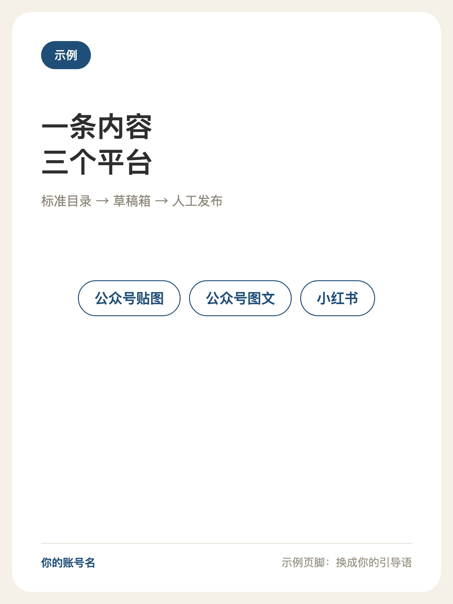
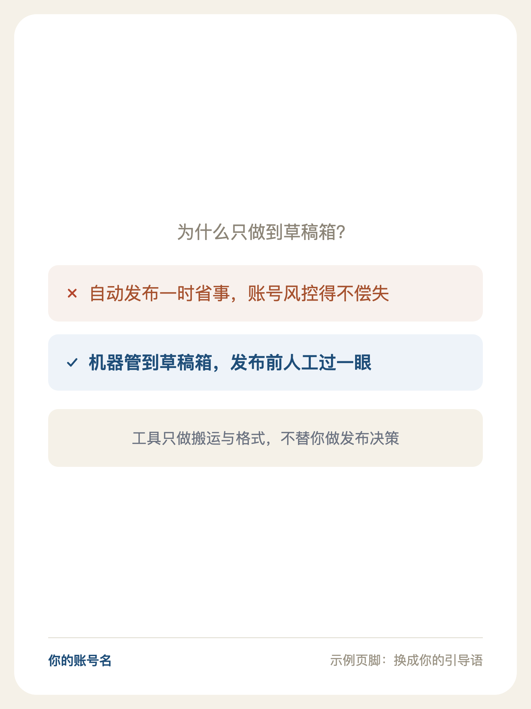

# draft-pusher

**把内容推进草稿箱，发表留给人。**

Push content into WeChat / Xiaohongshu drafts — using your own logged-in Chrome, via CDP.

---

你有没有过这种循环：内容明明写好了，却要花半小时在「打开 A 平台后台 → 上传图 → 粘贴标题 → 复制文案 → 保存草稿 → 打开 B 平台 → 再来一遍」里打转。

draft-pusher 把这段循环变成一条命令：**内容放成一个目录，剩下的交给 CDP**。

| 出口 | 形态 | 状态 |
|---|---|---|
| 微信公众号 · 贴图 | 图片卡片（newspic） | ✅ 完整流水线 |
| 微信公众号 · 图文 | 长文章（news） | 编辑器结构已探明（见 `references/`） |
| 小红书 | 图文笔记 | ✅ 完整流水线 |

附带两个渲染器：**贴图卡片渲染器**（9 种卡型，`cards.json → 1500×2000 PNG`）与**手机壳营销图渲染器**（真实 iPhone 15 Pro 几何，`截图 → 1242×1660`）。

<p>



</p>

<sub>↑ 上面三张图是这个仓库的渲染器真实产出的（跑 `examples/` 里的示例就能复现）</sub>

## 三条设计立场

**1. 用你自己的浏览器，而不是替你去登录。**
不模拟登录、不碰账号密码、不存 Cookie。工具通过 CDP（Chrome 调试协议）接管一个**你自己已登录的调试 Chrome**——你登录好，它来干活。

**2. 只推到草稿箱，绝不自动发表。**
发表前那一眼，永远值得。这条不是「暂未实现」，是设计立场：所有脚本的最后一步都停在草稿箱，发布动作由人在手机上完成。

**3. 后台标签，不抢你的屏幕。**
自动化全程在「后台标签」里进行——你正在看的页面不会被打断，笔记本锁屏了它也能跑。

## 工作模型

一条内容 = 一个目录（三个渠道共用一套约定）：

```
内容库/
└── 001-示例内容/
    ├── 标题.txt      标题（公众号限 20 字）
    ├── 文案.txt      正文 / 描述
    └── img/          图片，按文件名排序（首张即封面）
```

## 快速开始

```bash
git clone https://github.com/wsj414855138-code/draft-pusher.git && cd draft-pusher

# ① 启动调试 Chrome（首次要在弹出的窗口里登录公众号后台 / 小红书创作平台）
./scripts/start-chrome.sh

# ② 验证连通（应列出标签页）
node scripts/cdp.mjs list

# ③ 推一条内容进公众号贴图草稿箱
node scripts/mp_push_drafts.mjs --lib ./内容库 001-示例内容

# ④ 推到小红书草稿箱
node scripts/xhs_push_direct.mjs --lib ./内容库 001-示例内容
```

环境：**Node 18+**（脚本用原生 fetch / WebSocket，零 npm 依赖）、Chrome、Python 3.8+（仅渲染脚本需要，Pillow 可选）。

## 脚本清单

| 脚本 | 做什么 |
|---|---|
| `scripts/start-chrome.sh` | 启动独立调试 Chrome（独立 profile，登录态持久） |
| `scripts/cdp.mjs` | 瑞士军刀：list / eval / click / 截图 / 塞文件 / 输入 |
| `scripts/mp_push_drafts.mjs` | 微信公众号：贴图内容 → 草稿箱（图 + 标题 + 描述 + 可选小程序链接） |
| `scripts/mp_insert_link.mjs` | 微信公众号：给贴图插小程序链接（单独一步） |
| `scripts/mp_fetch_stats.mjs` | 微信公众号：回收已发表数据（阅读/分享/留言/点赞/收藏/转发） |
| `scripts/mp_bg.mjs` | 后台标签探针：无感核验任意页面（不抢焦点） |
| `scripts/xhs_push_direct.mjs` | 小红书：内容 → 草稿箱 |
| `scripts/render/render_tietu.py` | 贴图卡片渲染器：`cards.json` → 1500×2000 PNG（9 卡型） |
| `scripts/render/render_phone_mockup.py` | 手机壳营销图：App 截图 → 1242×1660 |

## 为什么是 CDP（而不是 Playwright / 坐标点击）

| 通道 | 受锁屏影响 | 登录态 |
|---|---|---|
| 坐标点击（CGEvents / AX） | ❌ 必须解锁 + 前台 | 借屏幕上的浏览器 |
| Playwright / Selenium | ✅ | ❌ 得模拟登录、存 Cookie、过验证码 |
| **CDP（本仓库）** | ✅ | ✅ 就用你的登录态 |

## 踩过的坑，都写进文档了

- 微信公众号后台：13 条实测坑点（ProseMirror 吞换行、受控输入清不掉、后台标签里拖拽失效……）→ `references/wechat-console.md`
- 小红书发布页：「发布」按钮藏在**闭包 Shadow DOM** 里，任何文字匹配都是假象，唯一可靠解法是 marker + 真实鼠标事件 → `references/xhs-publish.md`
- CDP 基础：启动参数、后台标签纪律、代理坑 → `references/cdp-notes.md`

## 常见问题

**Windows 能用吗？**
核心脚本（Node）跨平台；`start-chrome.sh` 是 macOS/Linux 的启动脚本，Windows 用户请手动启动 Chrome（参数照抄脚本注释里的那行）或自行改写。

**会不会有账号风险？**
工具以正常节奏运行（单篇串行、带间隔、异常即停），且只推草稿、不发布、不做互动。但任何浏览器自动化都存在平台侧风险，请自行评估、自行承担。

**公众号图文（长文章）能推吗？**
编辑器结构已探明并记录在 `references/wechat-console.md`，完整脚本目前以「贴图」形态为先。欢迎提交 PR。

**内容目录里的图片从哪来？**
自己准备，或者用仓库里的 `render_tietu.py` 从 `cards.json` 生成。

## License

[MIT](LICENSE)

---

<sub>免责声明：本工具仅用于管理你自己账号下的内容，请遵守各平台服务条款；因使用本工具产生的一切后果由使用者自负。工具不含任何账号凭证，不做验证码绕过。</sub>
